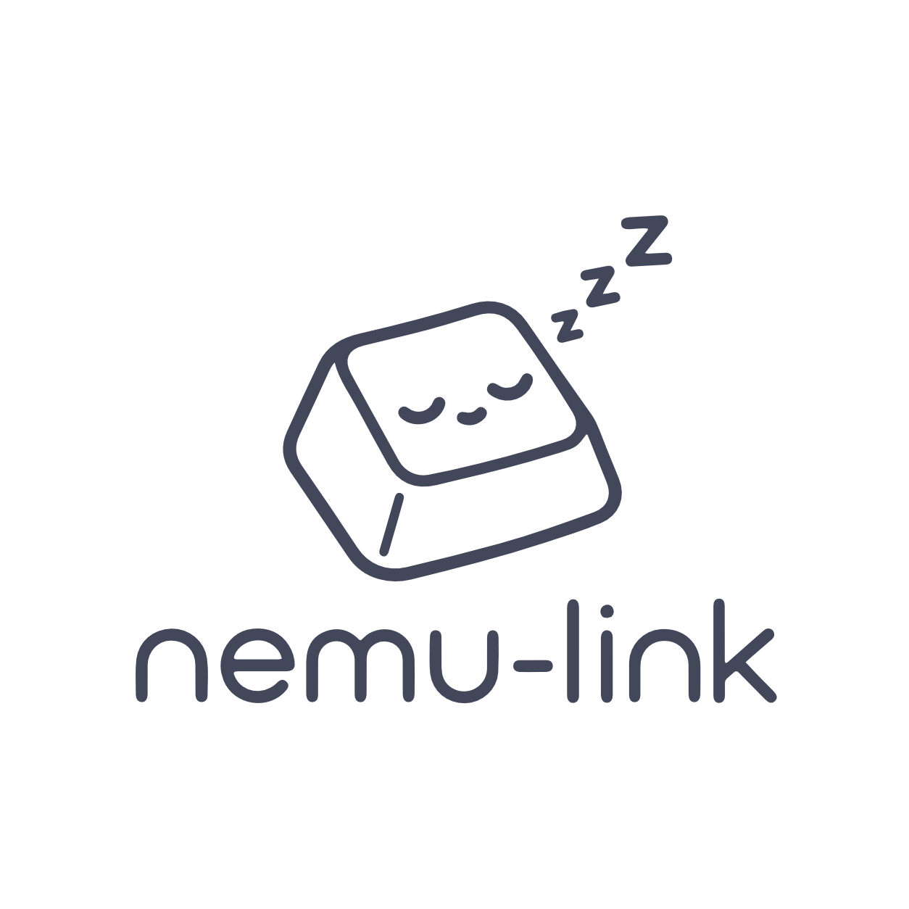
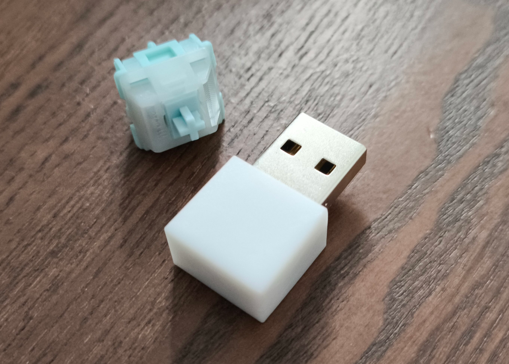
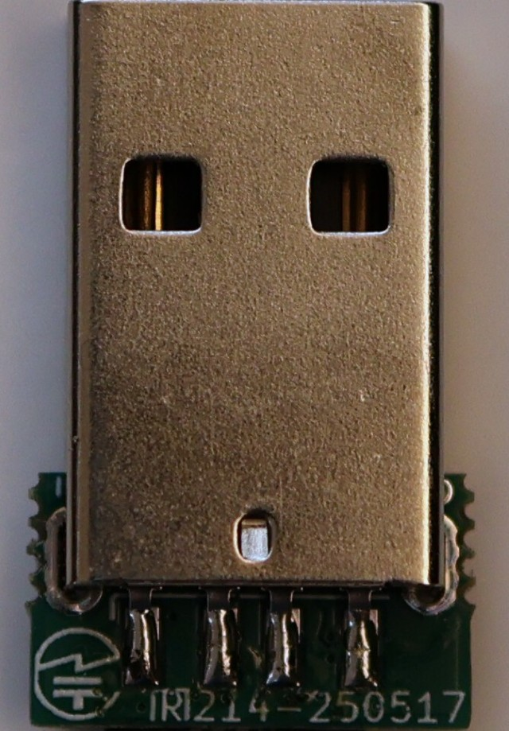
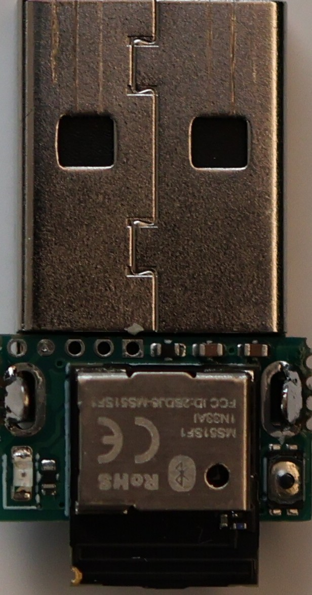
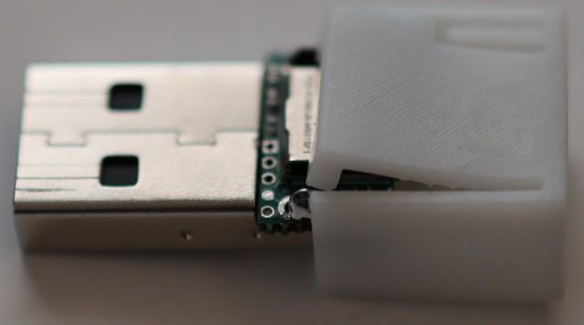
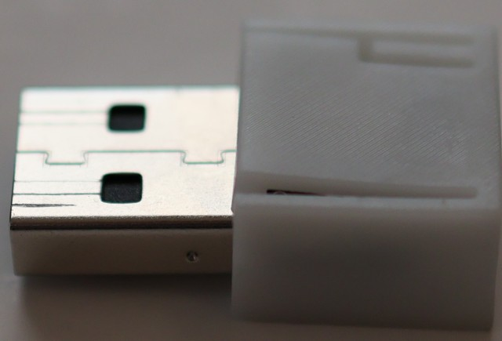
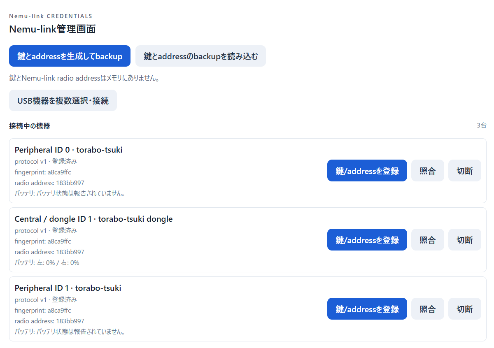

# nemu-link



nemu-linkは自作キーボードを独自2.4GHz無線に対応させるシステムです。専用の小型ドングルとZMKフォークを使用することで独自2.4GHz/BLE/USB接続を切り替えられるようになります。

独自2.4GHzモードではキーボード側は打鍵時以外はほとんど電力を消費しないので、省電力性能がアップします。特に、分割キーボードのセントラル側では条件によって消費電力が数十分の一くらいになる場合もあります。

分割キーボードの片側ばかり頻繁に充電が必要で困っているデスクトップユーザーにオススメです。

サイズ: 16mm x 28mm x 10mm (USBコネクタ部を含む)

nemu-linkドングルは[BOOTHの商品ページ](https://nogikes.booth.pm/items/9023384)から購入できます。



## ドングルの組み立て方

### USBコネクタを基板にハンダ付けする

USBコネクタを基板に差し込み、表面と裏面をハンダ付けします。

|| |
|-|-|

### PCに繋いで動作確認する

ドングルをPCに差し込み、UF2ブートローダが起動することを確認してください。

一度ケースに入れると取り出すのは困難なので、ケースに入れる前に必ず動作確認してください。

### ケースに基板を入れる

ケースの爪を持ち上げながら、ケースのスリットに沿って基板を奥まで差し込みます。

|| |
|-|-|

## ファームウェアをビルドする

まずradio構成を`2.4GHz only`または`2.4GHz/BLE/USB`から選びます。Dynamic Settingsを使う場合は、どちらかの構成へ最後の章にある追加設定を適用します。

どの構成も既存のkeyboard board、shield、keymap、matrix、physical layoutを使います。keyboard peripheralはNordic nRF52系SoCが必要です。nemu-link dongleはreceiver、split central、USB HIDを担当します。

### 共通: West manifestとGitHub Actions

既存configのWest manifestへZMK forkとnemu-link moduleを追加し、workspace rootで取得します。

```yaml
manifest:
  projects:
    - name: zmk
      url: https://github.com/sekigon-gonnoc/zmk
      revision: v0.4+nemu-link
      import: app/west.yml
    - name: zmk-feature-nemu-link
      url: https://github.com/sekigon-gonnoc/zmk-feature-nemu-link
      revision: zmk-v0.4
      import: config/west.yml
```

### 1. 2.4GHz only

独自2.4GHzのみで動かす構成です。各keyboard halfにperipheral IDを割り当ててビルドします。

```yaml
include:
  - board: <left-keyboard-board>
    shield: <left-shield>
    cmake-args: -DCONFIG_ZMK_NEMU_LINK_PERIPHERAL_ID=0
    artifact-name: keyboard-left-nemu-link

  - board: <right-keyboard-board>
    shield: <right-shield>
    cmake-args: -DCONFIG_ZMK_NEMU_LINK_PERIPHERAL_ID=1
    artifact-name: keyboard-right-nemu-link

  - board: nemu-link-dongle
    artifact-name: nemu-link-dongle
```

各peripheralの`.conf`ではnemu-linkとbattery reporting、Settingsを有効にします。既存configでBLE splitが有効な場合は、2.4GHz Only targetでは無効にします。

```conf
CONFIG_ZMK_NEMU_LINK=y
CONFIG_ZMK_BLE=n
CONFIG_ZMK_USB=n
CONFIG_ZMK_SPLIT_BLE=n
CONFIG_ZMK_BATTERY_REPORTING=y
CONFIG_SETTINGS=y
CONFIG_ESB_MAX_PAYLOAD_LENGTH=64
CONFIG_MBEDTLS_HEAP_SIZE=4096
```

### 2. 独自2.4GHz/BLE/USB構成

BLE splitと独自2.4GHzを実行時に切り替えられる構成です。CentralのUSBから入力するためには左右間はBLEで接続する必要があります。`&nl_mode`はradio mode、`&out`はZMK HIDの出力先を切り替えます。

各keyboard targetで既存のBLE split設定を維持し、nemu-linkとmode switchを有効にします。起動時から独自2.4GHzを使う場合は`BOOT_ESB`を設定します。USB HIDをPCへ出す側（BLE split central。keyboard構成によってはRight）のtargetでは`CONFIG_ZMK_USB=y`も有効にしてください。

```conf
CONFIG_ZMK_NEMU_LINK=y
CONFIG_ZMK_NEMU_LINK_MODE_SWITCH=y
CONFIG_ZMK_NEMU_LINK_BOOT_ESB=y
CONFIG_ZMK_BLE=y
CONFIG_ZMK_SPLIT_BLE=y
CONFIG_ESB_MAX_PAYLOAD_LENGTH=64
CONFIG_MBEDTLS_HEAP_SIZE=4096
```

```yaml
include:
  - board: <left-keyboard-board>
    shield: <left-shield>
    cmake-args: >-
      -DCONFIG_ZMK_NEMU_LINK_PERIPHERAL_ID=0
      -DCONFIG_ZMK_NEMU_LINK_MODE_SWITCH=y
    artifact-name: keyboard-left-ble-nemu-link

  - board: <right-keyboard-board>
    shield: <right-shield>
    cmake-args: >-
      -DCONFIG_ZMK_NEMU_LINK_PERIPHERAL_ID=1
      -DCONFIG_ZMK_NEMU_LINK_MODE_SWITCH=y
    artifact-name: keyboard-right-ble-nemu-link

  - board: nemu-link-dongle
    artifact-name: nemu-link-dongle
```

mode switchを有効にしただけでは利用者向けの操作は追加されません。overlayから`<behaviors/nemu_link.dtsi>`をincludeして`nl_mode` behaviorを定義し、keymapへ必要なbindingを追加します。引数`0`はBLE、`1`独自2.4GHz、`2`はBLE/独自2.4GHz toggleです。USB HID出力先の切替にはZMKの`&out`を割り当てます。

```dts
/* keymapの各layerにあるbindingsの例 */
bindings = <
    &nl_mode 0   /* BLE radio mode */
    &nl_mode 1   /* 2.4GHz radio mode */
    &nl_mode 2   /* BLE/2.4GHz toggle */
    &out OUT_USB /* USB HID output */
    &out OUT_BLE /* BLE HID output */
>;
```

`&out OUT_USB`と`&out OUT_BLE`はradio modeを変更しません。たとえばBLE radio modeに切り替えたあと、`&out OUT_USB`を選ぶと、BLE split transportを使いながらRightのUSB HIDからPCへ入力できます。BLE HIDを使う場合に限り、PCなどのhostへBLE接続します。

ドングルが不在の場合は、各キーボードごとに個別にBLEに切り替える処理が必要です。
そのためには、各キーボードごとの特定のキーの長押しでモードを切り替えられるようにします。

`CONFIG_ZMK_NEMU_LINK_MODE_CHORD=y`と、使うsourceのglobal key positionを記述したcontrol nodeを追加します。chord方式では`&nl_mode` bindingは不要です。`source-0`と`source-1`は各peripheral IDに対応します。

```dts
/ {
    nemu_link {
        compatible = "sekigon,nemu-link";
        source-0-switch-positions = <12 13>;
        source-1-switch-positions = <24 25>;
    };
};
```

positionsは同じsource上で同時に長押しするglobal key positionです。

### 共通のboard・overlay設定

以下のflash partition、radio overlay、conf設定、dongle設定は両方の構成で必要です。peripheralのradio設定は全peerで一致させます。

### 鍵を保存するflash領域

nemu-linkは各peripheralのapplication flash末尾4 KiBを鍵保存領域として使います。boardのflash layoutで
この領域をcode partitionから切り離し、`nemu_link_key_partition`というlabelの4 KiB fixed partitionを
Devicetreeに定義してください。Settings partition、bootloader、SoftDeviceなど既存の予約領域と重ならないよう、
board固有のflash mapを確認して配置します。専用`nemu-link-dongle` boardはこの領域を定義済みです。

BMP Boostは現行layoutのcode partitionが`0x26000..0xd7fff`なので、最後の4 KiBを鍵用に分ける例は次のとおりです。
このアドレスはBMP Boost用であり、他boardへそのまま使わないでください。

```dts
&code_partition {
    reg = <0x00026000 0x000b1000>;
};

&flash0 {
    partitions {
        nemu_link_key_partition: partition@d7000 {
            label = "nemu_link_key";
            reg = <0x000d7000 0x00001000>;
        };
    };
};
```

XIAO BLE（nRF52840、ZephyrのUF2 SD v7 layout）はcode partitionが`0x27000..0xebfff`です。末尾4 KiBを
鍵用に分ける場合は次のようにします。UF2 bootloaderとSettings領域は変更しません。

```dts
&code_partition {
    reg = <0x00027000 0x000c4000>;
};

&flash0 {
    partitions {
        nemu_link_key_partition: partition@eb000 {
            label = "nemu_link_key";
            reg = <0x000eb000 0x00001000>;
        };
    };
};
```

usu-aobaはboard定義のcode partitionが`0x27000..0xd7fff`です。末尾4 KiBを鍵用に分ける例です。
この例はusu-aobaのflash layout向けです。

```dts
&code_partition {
    reg = <0x00027000 0x000b0000>;
};

&flash0 {
    partitions {
        nemu_link_key_partition: partition@d7000 {
            label = "nemu_link_key";
            reg = <0x000d7000 0x00001000>;
        };
    };
};
```

### Devicetree overlay

nemu-linkを使うすべてのradio target（各peripheralとreceiver）の有効なoverlayに、同じradio nodeを
1つずつ定義します。既存overlayに同じ名前のsplit nodeがある場合は、二重定義せずnemu-linkのcompatibleと
propertyを統合します。

```dts
/ {
    nemu_link_split {
        compatible = "sekigon,nemu-link-radio";
    };
};
```

dongleにはローカルのkey matrixがないため、受信後に表示・処理する位置を`config/nemu-link-dongle.keymap`
とoverlayのphysical layoutに定義します。既存keyboardのkeymapとmatrixは維持します。

### Dongleの設定

Studio UIをdongle経由で使う場合は、matrixへ`studio-rpc-usb-uart` snippetを指定してUSB CDC ACMと
Studio RPC UARTを有効にします。

2.4GHz/BLE構成の場合、BLE CentralとDongleでキーマップを共有するため、`CONFIG_ZMK_NEMU_LINK_STUDIO_ENDPOINT=y`が必要です。その場合はcentralだけでなく、接続する全peripheralも同じStudio同期receiverを
実装したfirmwareでビルドしてください。

#### Trackballなどの入力デバイスを使う場合

trackballやdialなどのZMK input deviceをperipheralで使う場合は、入力デバイス本体に加えて、入力をsplit transportへ渡す
`zmk,input-split`と、入力イベントを購読する`zmk,input-listener`が必要です。receiver側にも同じ`reg`を持つ
`zmk,input-split` proxyと、そのproxyを購読する`zmk,input-listener`を定義します。peripheral側のlistenerだけでは、
dongleに届いたイベントはHID入力になりません。

次は、peripheralのoverlayにあるtrackballノードを`&trackball`とした例です。実際のphandle名に置き換えてください。

```dts
/ {
    split_inputs {
        #address-cells = <1>;
        #size-cells = <0>;

        trackball_input_split: trackball_input_split@0 {
            compatible = "zmk,input-split";
            reg = <0>;
            device = <&trackball>;
        };
    };

    trackball_input_listener {
        compatible = "zmk,input-listener";
        device = <&trackball>;
        status = "okay";
    };
};
```

Dongleのoverlayには、peripheralと同じ`reg`のproxyを定義し、そのproxyをlistenerへ接続します。receiverのproxyには
ローカルの入力デバイスがないため、`device` propertyは付けません。trackballの取り付け方向に応じて座標反転が必要な場合は、
`zip_xy_transform`をlistenerへ指定します。以下はX/Yを反転する例です。

```dts
#include <dt-bindings/zmk/input_transform.h>
#include <input/processors.dtsi>

/ {
    split_inputs {
        #address-cells = <1>;
        #size-cells = <0>;

        trackball_input_split: trackball_input_split@0 {
            compatible = "zmk,input-split";
            reg = <0>;
        };
    };

    trackball_input_listener {
        compatible = "zmk,input-listener";
        device = <&trackball_input_split>;
        status = "okay";
        input-processors = <&zip_xy_transform (INPUT_TRANSFORM_X_INVERT | INPUT_TRANSFORM_Y_INVERT)>;
    };
};
```

Dongleの`.conf`では`CONFIG_ZMK_POINTING=y`と`CONFIG_ZMK_INPUT_SPLIT=y`を有効にします。後者はoverlayに
`zmk,input-split` nodeがあり、splitが有効な場合に既定で有効になりますが、他の設定で無効化されていないことを確認してください。
`zmk,input-listener` nodeがoverlayにあると`CONFIG_ZMK_INPUT_LISTENER`も既定で有効になります。peripheral側もpointing supportを
有効にし、各デバイスの`reg`をreceiver上の対応proxyと一致させてください。複数の入力デバイスを使う場合は、receiver内で`reg`が
重複しない値を割り当て、それぞれのperipheral nodeとreceiver proxyで同じ値を使います。

## ファームウェアを書き込む

ドングルのボタンを押しながらPCに接続するとUF2ブートローダが起動します。

ビルドしたUF2ファイルを書き込んでください。

キーボード側についてもUF2ファイルを書き込んでください。ブートローダの起動方法については各キーボードのドキュメントを確認してください。

BMP Boostを使ったキーボードの場合、ブートローダのバージョンが古いと約700KB以上のUF2ファイルがうまく書き込めない場合があります。その際はブートローダ1.4.2以上に更新してください。


## 鍵情報を書き込む

nemu-linkドングルとキーボード間の通信を暗号化するための鍵をWeb UIから書き込みます。

鍵登録には各keyboard peripheralとreceiverへUSB接続できる必要があります。ZMK USB keyboard interfaceを
使う機器はそのHID reportから登録できます。USB keyboard interfaceを持たないUSB対応nRF52機器では、
nemu-link moduleがstandaloneの鍵登録用HIDを既定で有効にします。別の方法で鍵を登録する場合に限り、
`CONFIG_ZMK_NEMU_LINK_KEY_PROVISION_USB`を無効にしてください。

### nemu-link Studioにアクセスする

chromeまたはEdgeで[nemu-link studio](https://nemu-link-studio.pages.dev/)を開いてください。

`nemu-link管理`タブを開き`鍵とaddressを生成してbackup`ボタンを押すと、鍵と通信アドレスを保存できます。

左右のキーボードとドングルをPCにUSB接続し、`USB機器を複数選択・接続`をクリックして3台を選択・接続します。



`鍵/addressを登録`ボタンをクリックし、接続した左右のキーボードとドングルに同じ鍵/addressを順次登録してください。

キーボードとドングルを抜き差しすると、キーボード・ドングル間で通信できるようになります。

## 3. Dynamic Settingsあり構成（任意）

独自2.4GHz onlyまたは独自2.4GHz/BLE/USB構成へDynamic Settingsを追加すると、nemu-link Studioからfirmwareの設定を編集できます。
使うtargetの`.conf`へ次を追加し、Studio RPCとZephyr Settings/NVSを有効にします。

```conf
CONFIG_ZMK_DYNAMIC_SETTINGS=y
CONFIG_ZMK_STUDIO=y
CONFIG_ZMK_STUDIO_RPC=y
CONFIG_SETTINGS=y
CONFIG_SETTINGS_NVS=y
```

NVSを使うflash領域はboard側で用意し、鍵保存partitionやbootloader、application partitionと重ならないことを確認してください。
Dynamic SettingsはNVS partitionを自動で確保しません。受信RPCが大きい設定を使う場合は、必要に応じて
`CONFIG_ZMK_STUDIO_RPC_RX_BUF_SIZE`も増やします。保存と復元の手順、overlay schemaの記述は
[zmk-feature-dynamic-settings README](https://github.com/sekigon-gonnoc/zmk-feature-dynamic-settings)を参照してください。

nemu-link Studioから設定を編集するfeatureは、firmware側にschemaとruntime処理を持ちます。
すべてのfeature moduleは基盤の`zmk-feature-dynamic-settings`を必要とします。
使わないfeature moduleまで追加する必要はありません。

設定用のWEB UIもモジュール側に含まれているので、独自モジュールを作った場合でも、WEB UIを別途用意することなく、nemu-link Studioから変更できます。

`west.yml`へ、基盤moduleと使うfeature moduleを追加します。
次はMacroを使う場合の例です。`revision`は互換性のある公開tagまたはcommitへ置き換えます。

```yaml
manifest:
  projects:
    - name: zmk-feature-dynamic-settings
      url: https://github.com/sekigon-gonnoc/zmk-feature-dynamic-settings
      revision: <compatible-release-tag-or-commit>
    - name: zmk-feature-dynamic-macro
      url: https://github.com/sekigon-gonnoc/zmk-feature-dynamic-macro
      revision: <compatible-release-tag-or-commit>
```

Combo、Encoder、Tap Dance、Input Processor、BLE Profileを使う場合も、それぞれのprojectを同じ`projects`へ追加します。


| Module | 依存・必要な構成 | 機能 |
| --- | --- | --- |
| [`zmk-feature-dynamic-settings`](https://github.com/sekigon-gonnoc/zmk-feature-dynamic-settings) | ZMK Studio RPC、Zephyr Settings | schema生成、設定値の一時変更・保存・復元 |
| [`zmk-feature-dynamic-combo`](https://github.com/sekigon-gonnoc/zmk-feature-dynamic-combo) | Dynamic Settings、ZMK Combo listener | Combo slotの編集・保存 |
| [`zmk-feature-dynamic-encoder`](https://github.com/sekigon-gonnoc/zmk-feature-dynamic-encoder) | Dynamic Settings、ZMK sensor binding | encoderやhires dialの割り当て設定 |
| [`zmk-feature-dynamic-macro`](https://github.com/sekigon-gonnoc/zmk-feature-dynamic-macro) | Dynamic Settings、ZMK Studio RPC | runtime Macro slotの編集・保存 |
| [`zmk-feature-dynamic-tap-dance`](https://github.com/sekigon-gonnoc/zmk-feature-dynamic-tap-dance) | Dynamic Settings、ZMK behavior local IDs | Tap/Hold/Double Tap等のslot設定 |
| [`zmk-feature-dynamic-input-processor`](https://github.com/sekigon-gonnoc/zmk-feature-dynamic-input-processor) | Dynamic Settings、`CONFIG_ZMK_POINTING=y` | pointer感度、scroll/encoder mode等の設定 |
| [`zmk-feature-dynamic-ble-profile`](https://github.com/sekigon-gonnoc/zmk-feature-dynamic-ble-profile) | Dynamic Settings、BLE、ZMK Studio RPC | BLE profileの選択・状態表示 |

詳細なoverlay例、Kconfig、制約は各moduleのREADMEを参照してください。
